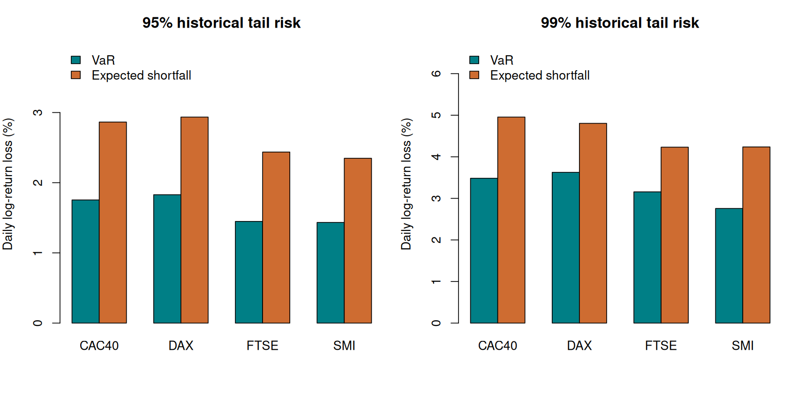
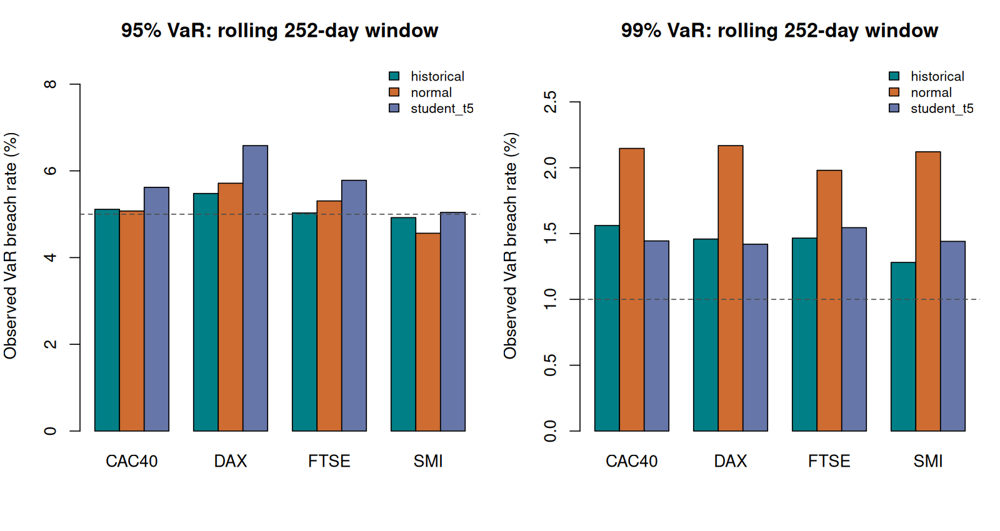

# European equity-index tail risk in R

**How do historical, Gaussian and heavy-tail assumptions change one-day loss estimates—and how often do their rolling VaR forecasts fail?** A reproducible risk analysis of CAC 40, DAX, SMI and FTSE 100 index series from 2015 through 2025.

Jihad Boussata · R · VaR · expected shortfall · rolling backtests · reproducible data acquisition



## Findings from the downloaded snapshot

| Index | 99% daily VaR | 99% daily ES |
| --- | --- | --- |
| CAC40 | 3.48% | 4.96% |
| DAX | 3.63% | 4.81% |
| FTSE | 3.16% | 4.23% |
| SMI | 2.76% | 4.24% |

All values are **percentage log-return losses**, L = −100 × log(P[t]/P[t−1]); positive values represent loss thresholds. The full-sample table is descriptive. The forward test uses the previous 252 observed trading returns for each next-return forecast.

At 99% confidence, rolling Gaussian VaR breaches occur on 1.98%–2.17% of forecasts across the four series, compared with a nominal 1%. This exposes tail underestimation in this sample. Fixed Student-t(5) assumptions improve some tail coverage but do not establish a universally best model.



## Reproduce

Use Python 3.12 for downloading (standard library only) and R 4.3.3 or compatible later R for analysis (no CRAN packages).

```bash
python scripts/download_prices.py
Rscript tests/run_tests.R
Rscript scripts/run_analysis.R
```

Yahoo Finance is a live source: it can revise observations or restrict requests. Preserve the downloaded CSV and its manifest to reproduce an exact snapshot offline. The downloader explicitly selects adjusted close where the series provides usable values, otherwise records its close fallback. A failed download is reported; no synthetic market data is substituted. Use `--data path/to/index_prices.csv` and `--output another-directory` for a separate analysis.

## Methods

- Historical VaR uses the inverse empirical CDF. Historical ES averages the upper tail with fractional boundary weight, so ties and small samples have a defined treatment.
- Gaussian VaR/ES use the estimated loss mean and standard deviation.
- Student-t VaR/ES use **fixed df = 5**, scaled to the sample standard deviation. Degrees of freedom are an assumption, not an estimated fit.
- Seeded Gaussian Monte Carlo (100,000 draws) checks the analytic Gaussian calculation; it is not a separate economic risk model.
- Rolling forecasts exclude the observed return being forecast. Coverage tables report breach counts/rates, runs and an explicitly iid-binomial reference test.

`R/risk.R` is the reusable core; `scripts/` handles acquisition/reporting; `tests/` checks ES boundary weights, ties, translation, Gaussian Monte Carlo agreement and absence of lookahead. [results/](results/) contains the numeric report and provenance manifest. Individual rolling forecasts are regenerated locally and git-ignored to keep the repository compact.

## Scope and attribution

This develops my European-index risk-measures coursework into a reusable analysis. Historical prices come from Yahoo Finance; the retrieval URL, chosen field, dates, currencies and checksums are recorded in [the manifest](results/data_manifest.json). Raw prices are not redistributed.

These are local-currency index series, not directly comparable investable total-return portfolios. [DAX's published performance-index construction](https://stoxx.com/index/DAX/) differs from price-index conventions used by other headline series; adjusted close does not harmonize dividends or currency. Trading calendars also differ. There is no currency conversion, portfolio aggregation, liquidity adjustment or volatility model. The tail-loss comparison in coverage.csv is descriptive and is **not a formal ES backtest**. See [methodology](docs/METHODOLOGY.md), [data](data/README.md) and [changes](docs/CHANGES.md).
